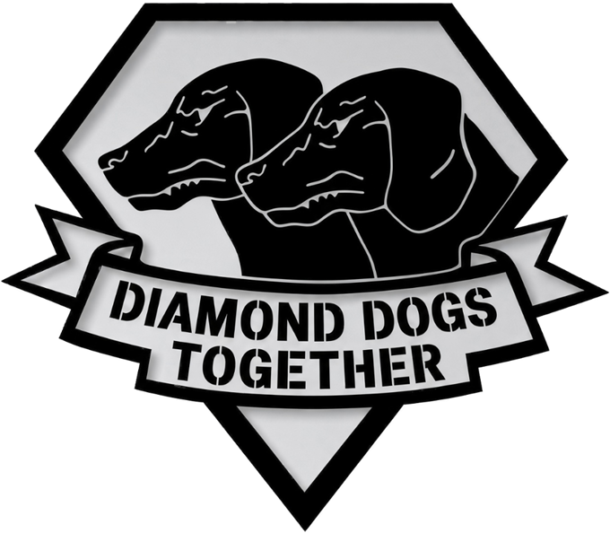
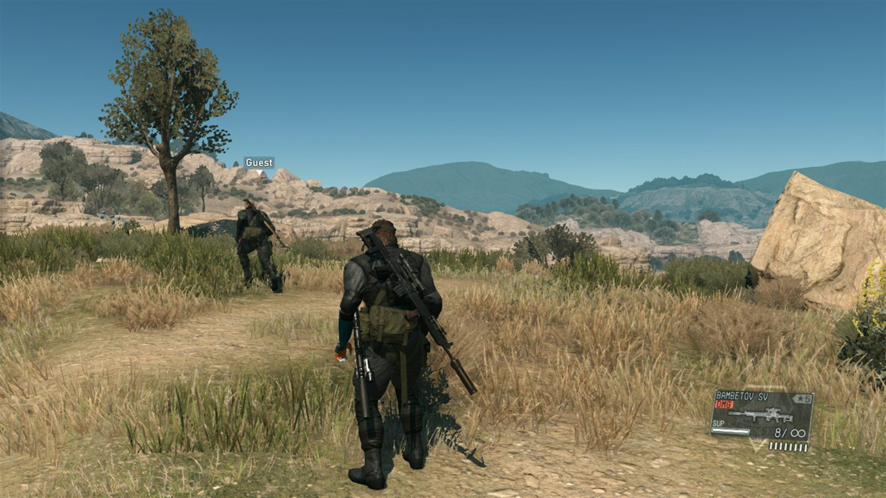

<p align="center">
  
</p>

<p align="center">
  <b>Two-player online co-op for Metal Gear Solid V: The Phantom Pain</b><br>
  Windows · Steam · version 0.15.3 (development build)
</p>

<p align="center">
  
</p>

You and a friend each run your own copy of MGSV and play in the same world. You see each other move, fight, climb, drive and hide.

**What you can play today:** Mother Base and the Afghanistan and Africa free roam. Story missions, the hospital prologue, side ops and cutscenes are **not** co-op yet; see the [campaign roadmap](docs/CAMPAIGN-ROADMAP.md).

## Download

Get `DiamondDogsTogether-<version>.zip` from [Releases](https://github.com/TrollTaylor/diamond-dogs-together/releases). Both players need the **same version**.

The launcher updates itself: when a new version is out, **Update now** downloads it, installs it and restarts Diamond Dogs Together.

The complete source code of each version from 0.14.4 on is `DDT-source-<version>.zip` on the same release page; older packages carry it as `mgs-coop/source.zip`. It is made from the commit of this repository that `mgs-coop/package.json` names (`build.source_commit`), with MinHook's source in place of its submodule link and without the files the programs are not built from (README pictures, git settings, developer notes and scripts, evidence files; [THIRD_PARTY_NOTICES.md](THIRD_PARTY_NOTICES.md) lists them). The tag `v<version>` can sit on a later commit: at least the record of that package in `docs/STATUS.md` is written after it is built. You do not need it to play. The launcher's only network access is that update check against this repository's releases and, on **Update now**, the download of the new zip.

## Requirements

- MGSV: The Phantom Pain on Steam, version 1.0.15.4, with **no other mods**.
- Windows 10 or 11, and Steam running and logged in.
- A save that can **Continue** into Mother Base or free roam (not one still in the hospital opening).

## Install

1. In Steam, right-click MGSV and choose **Manage → Browse local files**. This opens the game folder, the one with `mgsvtpp.exe`.
2. Extract **everything** from the zip into that folder: `DiamondDogsTogether.exe`, `dinput8.dll` and the `mgs-coop` folder.
3. Run **DiamondDogsTogether.exe**.

The first start gets co-op ready by itself, in about a minute (the Play page shows *Getting co-op ready...*; there is nothing to click):
- It checks your game files.
- It backs up your real saves.
- It makes a co-op copy of your save.
- It builds the mod's runtime file from your own game files.

Launching MGSV normally from Steam still plays your real save, with the mod inactive.

## Play

1. **Host:** open **Play → Host → Host game**. MGSV starts and a join code is copied to your clipboard. Send it to your friend, or invite them from the Steam overlay once you are in the game. The host always plays Snake.
2. **Join:** open **Play → Join**, pick your character, paste the code and press **Join game**. Or tick **Wait for a Steam invite**. Character choices:
   - **Story: Quiet or Ocelot.** Quiet while she is on your team, Ocelot otherwise.
   - **Ocelot.**
   - **Diamond Dogs soldier,** male or female.
   - **Your custom character.**
3. **Both:** choose **Continue** and meet up in Mother Base or free roam. If your saves are at different points, the host's save is copied to the joiner automatically and their game restarts once.

Keep the launcher open while you play; its **In game** page shows the connection and your partner's status. Quit MGSV normally when you are done.

## What works

- **Your partner's body:** you see their body, gear and weapons as they walk, run, crouch, crawl, aim, reload and throw.
- **Movement:** ladders, ledges, the cardboard box and item pickups.
- **Your partner's aim matches their screen:** when your partner holds aim or fire but their own game doesn't let them (a lethal gun at Mother Base, or while they climb a ladder), their character on your screen keeps the gun down and fires nothing, just like on their screen. When they really aim, you see them aim. Seen in testing on both screens, in both directions. A held aim or fire trigger on a gamepad is now dropped the same way. When your partner is in the cardboard box on their screen but their character on yours is not, a box dive no longer sends their character diving across open ground on your screen. Their character also stands up, crouches or goes prone on your screen while they hold an aim their game refuses, or the reload key.
- **Vehicles:** your partner drives; you can ride in the front or back seat of a jeep. In Afghanistan and Africa free roam, a world vehicle that nobody drives stays where it was left on both screens and has the body damage the host's PC gives it; either player's Fulton of it removes it on both screens and adds it to both players' Mother Base, one destroyed on the host's PC disappears from the partner's screen, and one the guest blows up near them is destroyed on the host's screen too. At Mother Base too, a Fulton or the destruction of a parked vehicle removes it on both screens. If your partner's vehicle is missing on your screen, your partner is hidden and a message says so, instead of them gliding along with no vehicle.
- **Your partner at the wheel:** when your partner drives a jeep, their character on your screen sits with both hands on the wheel when they go straight and turns the wheel left or right as they steer, and climbs out normally when they get off. Before, it always looked like it was turning hard left. Seen in testing on both screens, in both directions.
- **Riding D-Horse together:** in free roam (tested in Afghanistan; Africa not tried yet), when your partner rides D-Horse you now see them sitting in the saddle on your screen, moving with the horse at a walk, trot or gallop, instead of vanishing until they get off. When they get off, the horse stands where they left it on both screens, and your first E mounts it. **Riding behind your partner:** press E beside the horse your partner rides and you sit behind them on both screens while they walk, trot and gallop; hold E to hop off (you land on the ground the horse just crossed, about 2 m behind it, or where you stood when you got on); if they get off, you are both off. A fix is in for a short game stutter dropping you off the seat on your partner's screen while you ride behind (before, they could then see you on the ground behind the horse for the rest of the ride); no test since has had a stutter long enough to show it at work. Seen in hidden two-copy tests on both screens, in both directions, also with a bad connection simulated; not tried in a game with two people yet.
- **Helping each other:** revive a downed partner, wake a sleeping one, and carry them. Putting your partner down while you run no longer slides them over a deck edge or a cliff.
- **Melee:** one CQC press on your partner knocks them down; they wake after about 30 s or when you wake them. A CQC press aimed at a soldier next to your partner takes only the soldier.
- **Shared world:** enemy kills, sleeps and Fultons, alerts, time and weather. At Mother Base the staff stand in the same spots on both screens, and what happens to them is shared too.
- **Guards in the same place:** in Afghanistan, Africa and Mother Base the guards near either of you stand where they stand on the other screen (Africa was not tried in testing). Whoever is nearer a guard decides where he is: the guards you fight far from your partner line up on your partner's screen too. A guard that drifts apart now glides back in small steps instead of hopping. In testing the two copies of a guard stood about 0.7 m apart at Mother Base (under 1.7 m nine times in ten) and about 0.9 m apart around an Afghanistan outpost in a firefight (under 2.5 m nine times in ten; before this version 2-3 m, with running guards 7-10 m ahead between hops). A kill, knockout or Fulton happens on the other screen where that guard stands there: in testing within 1 m (in the last friend session one landed on a copy 95 m away). A guard killed by crossfire on one screen dies on the other too, and a crossfire knockout wakes back up instead of staying asleep on one screen (only the first was seen in testing). When the host's base calms down after an alert, the guest's does too. Bodies that are dragged or that crawl lie in the same spot on both screens once they stop, and a held-up guard raises his hands on both screens (the hands-up was not seen in testing). A guard that is moved to where the other screen has him is now asked for that copy's own height (before, the mod asked for 0.4 m below it and the game usually put him back on the floor), so he seldom drops through a thin floor to the level below (in testing 859 of 865 moves landed within 0.1 m of that height and one guard dropped about 5 m; before, about 1 in 100 dropped 2-4 m). A long firefight no longer makes the mod stop moving guards for the rest of the session (in two 4.5-minute firefight tests the game turned down 17 and 19 moves on the host, most likely of guards that PC had not loaded; the mod kept going and tried each of those guards again a few seconds later, and most of them moved again, but in each test one guard was not moved again before the test ended). Guards no longer start hunting the guest because of a fight on the host's side.
- **Patrol trucks (Afghanistan free roam):** the enemy patrol trucks and their crews drive and stop where the host's do, on both screens: the crews get out and back in at the same stops. In testing, once a truck followed the host's, its two copies stayed within about half a metre of each other while it drove (never more than about 2 m; for about the first minute after the guest joins, a truck near the guest can still be far off, see Patrol trucks under Known limits), and 20-40 seconds after getting out the crews stood within about 2-5 m of where the host's stood. In Africa and at Mother Base the patrol trucks still move separately on each PC.
- **Guards on walls and ledges:** a guard who climbs onto a wall or a ledge now stands at the same height on both screens about 1 s after he stops climbing: on the other screen his copy jumps up (or down) to him once, in plain view. In the last three tests (the newest with nothing named) all four such moves (2.4-5.8 m) left him at his height within 0.02 m, and in two of them the guest on the wall top saw him standing on it while the host's binoculars showed him at the top of the wall.
- **Binoculars:** when your partner looks through binoculars, their character on your screen no longer raises a gun: it stands (or crouches) with its gun put away. Seen in testing on both screens, in both directions.
- **Fultons on both screens:** when your partner Fultons a guard, you see your partner kneel at the guard to attach the balloon, and the guard then goes up under a balloon on your screen too. A vehicle either player Fultons goes up under the game's own balloon on the other player's screen as well, instead of just vanishing: a vehicle the host Fultons now goes up on the guest's screen too. It starts to go up there as soon as the balloon is attached, not a few seconds later. The lift on your screen looks like your partner's Fulton (the balloon, or the wormhole if they use it), not your own. A Fulton still adds the soldier or vehicle to both players' Mother Base. Seen in testing on both screens: guards in both directions, vehicles from the guest to the host.
- **Shared progress:** the host's travel, checkpoints, and game over with continue for both players. When the host's mission fails because a Mother Base staff member died, the guest is told why before both reload; a guest who presses Continue on a Game Over screen is told it waits for the host. The F9 kill rows refuse at Mother Base (a dead staff member fails the mission).
- **Arriving together:** a joiner flying in to free roam or Mother Base starts from the helicopter's route like a normal arrival, and a checkpoint the host saves waits until the joiner is off the helicopter. If an arrival helicopter still freezes, the joiner's arrival restarts by itself after 20 s; a host whose own helicopter freezes is told "Stuck in the helicopter? Pause and choose Restart."
- **Online play:** through Steam, with no port forwarding.
- **Character (F9 debug menu > Player > Character (you)):** either player switches to Snake, a Diamond Dogs soldier (male or female), their custom character, or back to their default, right away and for the rest of the session; the partner sees the new look (a custom character as Snake). After a fresh start in Africa the host stayed Snake on both screens. Ocelot and Quiet: pick them in the launcher.
- **Travel (F9 debug menu > World):** **Go to Afghanistan**, **Go to Africa** or **Go to Mother Base** takes both players there with no helicopter ride, in under half a minute, with the camera behind each player when you land; either player can press it. **Bring partner here** puts your partner right in front of you when you are in the same area; if your partner is somewhere else it says "Your partner is in another area: use Go to first." A short message tells each player what happened.
- **Game rules (F9 debug menu > World):** **Wormhole Fulton off** gives you the balloon Fulton back (**Wormhole Fulton on** returns the instant one); nothing changes in your save. The host's **Weapons at Mother Base** lets both players use their loadout weapons there (**Stock Mother Base rules** goes back); any kill at Mother Base still fails the mission.
- **Give weapon (F9 debug menu > Player):** pick a gun or item from the list and you get it with full ammo; your old gun in that slot drops at your feet.
- **Friendly fire (F9 debug menu > Partner):** the host turns friendly fire on or off for both players; a guest's press asks the host.
- **Spawn enemy here (F9 debug menu > Enemies, host):** brings the nearest guard 5 m in front of you, facing you and armed, in Afghanistan and Africa free roam; your partner sees the same guard there.
- **Spawn vehicle (F9 debug menu > World):** **Spawn jeep** or **Spawn truck** brings one of the area's jeeps or trucks 6 m in front of you, facing your way, on both screens, in Afghanistan and Africa free roam. Either player can press it (the guest's press asks the host). You can then get in and drive it together. While you sit in a vehicle it says "Get on foot first" instead. Seen in testing on both screens in Afghanistan; not yet tried in Africa.
- **Supply drops:** an AMMO / FULTON supply drop that either player orders from the iDroid falls at the same spot on both screens: both see its landing marker and its height count down together, the partner is told "Your partner called a supply drop: the box lands at the same spot for both of you.", and the player who ordered it gets the supplies as usual. Seen in testing on both screens.
- **Launcher:** opened before Steam has logged in, or while MGSV still runs, it now gets co-op ready by itself once Steam is logged in or MGSV has closed, and Play waits for Steam to let go of the last game.

Game rules, Give weapon, Friendly fire, Spawn enemy here, the Mother Base staff and vehicle sharing, the arrival fixes and the other changes above that are new in 0.14.6 have not been tried in a two-player game yet.

New in this version and not tried in a game with two people yet (only in the hidden two-copy tests): everything in "Guards in the same place", "Patrol trucks" and "Binoculars" above. Not seen even there: a held-up guard's raised hands on the other screen, a crossfire knockout waking back up, and the guest's own kill of a guard it fights far from the host being placed on the host's screen first.

New in 0.14.7 and not tried in a game yet: a vehicle the host Fultons going up on the guest's screen, a partner's vehicle going up as soon as the balloon is attached, the lift in your partner's Fulton look, and the gamepad, cardboard box and stance cases of your partner's aim.

## Known limits

- Story missions, the hospital prologue, side ops and cutscenes are not co-op yet.
- **Enemies:** each PC still runs its own guards' brains; only their positions, routes and what happens to them are shared. A guard's animation is his own: a guard his own game keeps still can slide along to where the other screen has him, and on one screen a guard may be shooting while on the other he only stands there. Each PC's guards see and hear only that PC's player, so a guard may shoot at you on your screen while on your partner's screen he looks elsewhere. A carried body stays where it was until it is put down. On the host's screen the guest's character may not show the carry: in the last test it stayed crouched while the guest carried a sleeping guard (seen in the log), though the host's copy of the guard was still moved to where the guest put him. Once, after the guest carried a guard a few steps, the guest's character on the host's PC went into a lying pose for the rest of that test while the guest stood (seen in the log; on the host's screen the character was hidden behind cover). In a big firefight the game sometimes turns down a move of a guard who is far from that PC's own player (in testing 40-140 m away; most likely he is not loaded there, which is not confirmed); that copy of him stays where he was, and the mod tries him again a few seconds later (up to 30 s apart). In firefight tests, on the host's screen the copies of the guards fighting the guest far away were 11-20 m or more from where the guest's screen has them one time in ten, and on the guest's screen a copy of a guard fighting the host was once 46-75 m from the host's copy for about 25 s between moves. Reinforcements can arrive far off on the guest's screen: in the last firefight test two guards driving in were 90-350 m from where the host had them, one for 26 s and one for 78 s (in their vehicle on the guest's screen, then turned down by the game), before the mod could move them in. When the guest falls off the cliff by an outpost and on through the ground below it, and is down there, the host's copies of those guards are not moved to where the guest's screen has them: in the last three such tests half of them drifted up to 29-52 m off (some 49-65 m) while the guest was down, and in the newest test (it happened in a firefight) half drifted 16 m or more and one in ten 27 m or more (seen in the logs). When the mod moves a guard on the guest's screen to where the host's screen has him, the move can startle him: at one outpost spot he radioed that a possible intruder had attacked him and his outpost went on caution on both screens (in two of three earlier tests). A dead guard can lie several metres apart on the two screens (6.8 m in one test; a dead guard's copy is not moved). While a guard climbs onto a wall or a ledge, his copy on the other screen waits 2-5 m below him for about 3 s before it jumps up to him (see "Guards on walls and ledges"); only a guard within 60 m of you is moved up this way on your screen, so one near your partner but more than 60 m from you is not. (The plan's last step, one brain for every nearby guard, is only a test switch: `soldier_puppet=1` in lab.ini makes the guest's guards puppets of the host's, but those never notice the guest. A far-watch mirror is a test switch too: with `soldier_act=1` the host's guards far from the guest are meant to walk on the guest's screen as on the host's while their outpost is calm or cautious (`soldier_act=all` also in an alert, aiming and shooting); in the last tests they walked at about the right speed but often on another path, and some stood still and then jumped 15-20 m, so it is off. A newer test switch for it, `act_plan=1` (with `soldier_act=1`), makes those guards plan their own path to where the host's copy walks: in the newest tests all four guards walking in a calm outpost far from the guest were taken by the mirror (before, one of four), though each was mirrored only 42-89 % of the time his host's copy walked (the mirror often let a guard go and took him again within about 1.5 s); two of them walked within about 1 m of the host's copies (half the time within 0.3-1.2 m), and one pair of frames showed a guard walking along the same wall at the same spot on both screens. It stays off: a third guard cut the corners of his route (his host's copy walks the route's line, he walks straight to the end of each leg; half the time 2-3.5 m off, nine times in ten 6.6-10.8 m, at worst 11 m); taking a guard who walks far from his copy makes him jump there on the guest's screen, 18-49 m about five times a test (before, once a test), and in one test five guards jumped 16-45 m at once when their outpost went on caution; another guard stood still on the guest's screen while the host's copy walked, at the spot such a jump had put him (why is not known; he walked once let go); and guards it let go stood still 10-30 s, some at once and some after walking on (only 5 of 64 walks it let them walk on were seen reaching their end). Two more test switches, off: `place_reach=1` moves the guards your partner fights 60-160 m from you on your screen too (in earlier tests, through binoculars from about 110 m, the host saw the guard the guest stood next to on the same spot, 0.1-1.4 m apart, and the host's copies of the guards the guest fought stood within 2-2.7 m of the guest's nine times in ten, 7 m without it; in the newest test the host's binoculars showed only that guard's marker at 70-72 m and no body, while in a test without it the host saw the guard by his marker at 67 m) and, when the game turns down such a move, asks it to load that guard and tries him again as soon as the game allows (in the last test 55 of 59 such tries ended with the guard moved, most about 3 s later); it stays off: in the last test the host's copies of the guards the guest fought stood within 2.3 m of the guest's nine times in ten until the guest was downed (after that half of them drifted up to 52 m apart within 25 s, some 65 m; in a test without it, up to 29 m, some 49 m), and in an earlier test one far guard it loaded dropped about 4-5 m on the host's screen for several seconds; `body_dead=1` lets a dead guard's body follow when it is moved on the other screen (not yet seen in a test). The wall and ledge move ("Guards on walls and ledges") is on now; `drive_vert=0` in lab.ini turns it off. `quiet_place=1` moves such a guard on the guest's screen without startling him (in its first test the guard who radioed before stayed calm), but in the test after that some guards it moved while they were walking went 10-17 m off again within 2 s; a later version moved only a guard who stood still: in its test it was asked 18 times for 6 guards (17 of them in a firefight) and moved a guard that way twice, both in the firefight; one of those two then ran after his copy on the host's screen and the other walked off when a test step put the guest right beside him; the newest version moves walking guards too and has each plan his walk again from where it put him: in its test it moved guards 42 times (40 of them walking) and none was startled, but a walking guard then walked on along his own route, up to 10 m from where the host's screen had him 2 s later (in 20 of 35 checks more than 3 m); `range_flat=1` (it now also uses the partner's network position while their character is hidden for distance) did not keep the host's copies in place while the fallen guest was down; both are off.)
- **Vehicles:** trucks that enemies drive move separately on each PC (except the patrol trucks in Afghanistan free roam, see Patrol trucks below), and so does an enemy vehicle that drives off in a fight: one the guest destroys after it has moved stays destroyed only on the guest's screen. Wheel damage and fire are not shared, and damage the guest does to a vehicle without destroying it is undone within about 10 seconds. A vehicle the guest destroys from more than about 300 m away (or while the host sits in it on the host's PC) stays destroyed only on the guest's screen. A vehicle the guest destroys is destroyed on the host's PC with the game's own explosion there, soldiers inside included, unless either player stands near the host's copy (within 15 m of a jeep, 50 m of a truck, armoured vehicle or tank): then a named one just disappears on the host's PC, and others (one with soldiers inside, or an unnamed one) wait until both players are clear, for up to 2 minutes; after that the vehicle stays destroyed only on the guest's screen. While D-Dog still sits in the host's copy, the host waits up to 2 minutes for the seat to empty. A vehicle destroyed on the host's PC leaves no wreck on the guest's screen. In Mother Base a parked vehicle's position and damage are not shared yet.
- **Melee:** the striker's punch is not drawn on the victim's screen.
- **Patrol trucks:** in Afghanistan free roam, a patrol truck that is within about 400 m of the guest when the guest joins stays the guest's own for about a minute (in testing 54-60 s, with its crew far from where the host's is), and then jumps to the host's. Only the trucks the host's game has seen with a crew aboard follow the host's: on the guest's screen the crews of the other trucks are taken off their trucks, so if such a crew gets in later on the host's screen, the guest may see that truck drive off empty, and enemy reinforcements that come by truck may not reach the guest's screen (not tried in testing). A crew that gets back in after a stop does so up to about 6 s later on the guest's screen (seen once in testing). In Africa the patrol trucks still move separately on each PC.

- **Partner at the wheel:** the wheels of the vehicle your partner drives do not turn or spin on your screen, though the vehicle moves. The steering pose was tested with a jeep and a keyboard driver; a truck uses the same pose but was not tried.
- **Partner's aim:** your partner's character starts to aim on your screen a moment after they do, so a single quick shot fired the instant they raise the gun may not be drawn. The gamepad, cardboard box and stance cases (see What works) are new in 0.14.7 and have not been tried in a game.
- **Fultons:** on your screen a guard your partner Fultons goes up about 10 s late (when it has already gone up on their screen). If your partner's balloon fails after it was attached to a vehicle, the vehicle may still go up on your screen (not seen in testing). For about 5 s after a lift in your partner's Fulton look, your own Fultons use that look too. Holding the action key for more than a second at something else might make your partner's character show the Fulton kneel on your screen (not seen in testing).
- **Animals and prisoners** are not shared.
- **Spawn vehicle** only brings jeeps and trucks the area already has (no armoured vehicles or tanks, and not at Mother Base or in story missions), and the one it brings leaves its old place on the map. In Afghanistan every truck belongs to an enemy patrol, so soldiers can later drive a brought truck away (in Afghanistan free roam the guest's copy should now follow the host's; not tried in testing). If the guest's game can't take the vehicle the host brings (for example the guest stands right where it would go), it moves only on the host's screen (not seen in testing).
- **Buddies** (D-Dog, Quiet, D-Walker) are not shared yet: each PC keeps its own. D-Horse: see Mounts.
- **Seats:** you can ride along in a jeep's front passenger seat or its back seats. When the driver's D-Dog already sits in the jeep's front seat you get a back seat; the dog gets in with the driver, in testing even from about 300 m away. A truck's cab seat works in testing but is off in this version; a truck's bed and the inside of armoured vehicles and tanks aren't available yet. While the vehicle moves, your partner can appear beside their seat for a moment. A front-seat passenger sits in the seat on both screens, also while the jeep drives, and climbs out over the right side. In the front seat your camera can end up inside the jeep or a nearby object when the jeep reverses into something. When the driver sets off while you are still getting into the front seat, your camera now stays with the jeep (shown in testing on the Afghanistan jeep, not yet when you get into a jeep that is already moving or at Mother Base); before, it stayed where you got in for about 3 s while the jeep drove away and then jumped to it. After you get out of the front seat or the left back seat the camera shows the driver up close for about 2 s (3 s from the back seat) before it turns to look along the jeep behind you; if you aim while getting out it turns after you stop aiming, and only turning the camera yourself keeps it where you put it: walking away does not. Only pressing E takes an empty jeep's driver's seat: standing at its door takes nothing, so a partner waiting at the door no longer locks you out. When the guest presses E at an empty jeep, Snake stands at the door for about a third of a second on a slow connection (the host's game decides) and then gets in, with no second press. If you both press E at the same jeep at the same moment, the host drives and the guest gets a passenger seat; with the host's D-Dog out the guest waits at the door for about a third of a second while the dog takes the front seat, then gets into a back seat, the same seat on both screens (the back right seat in testing; the guest's screen does not show the host's dog). If the guest presses E a moment after the host started getting in, before the host's dog jumped in, the guest waits at the door a moment (up to 0.7 s; 0.12-0.17 s in testing) and then gets into a back seat, again the same seat on both screens (the guest's own screen does not show the dog in the front seat). A host who presses E at the driver's door while the guest is getting in is told that the partner reached the driver's seat first; just standing at the door shows nothing. While that message is up, and while you stand at a vehicle your partner drives, you can't Fulton anything. Shooting from a jeep's seats works only in part: from the front passenger seat and the back seats you can aim and fire, the camera stays on your aim when you fire (you can keep turning and aiming with the mouse or stick while you shoot) and comes back to normal when you stop aiming, and from a back seat your shots hit what the red reticle is on across the jeep (tested on guards 8-21 m away from a stopped jeep, also online; not yet tested while the jeep moves). A shot from a seat whose line passes through your own jeep now starts just outside the jeep, so it does not damage your jeep (unless what you aim at is right next to the jeep). Online on the Afghanistan jeep, with the host in the seat aiming over the shoulder, a shot from the front seat back across the jeep and one from the left back seat down past its tail each took almost a third of the jeep's life without this fix and nothing with it; the back seats of the Africa jeep showed the same in testing, and online its right back seat did no harm. The gun won't fire at a target low beside the jeep or down into it. While you aim from the front seat or the left back seat and the gun can fire, the game now switches to its first-person view by itself (the over-the-shoulder view there is blocked by your own leg or the jeep's side), in both roles, also online; the right back seat keeps the over-the-shoulder view. If the jeep blocks the gun when you raise it (the red no-fire mark, for example aiming across the driver from the front seat), the view stays over the shoulder. Turning the aim to a clear direction then switches to first person in the same aim (tested online from the front seat). In first person, parts of the jeep can fill much of a scoped rifle's view in some directions, from the front seat and from the left back seat. A shot fired that way leaves the view on your aim (it does not climb). When you stop aiming, and when you get out (also while aiming), the normal camera comes back, and your next aim on foot is over the shoulder. Tapping F while aiming switches back to over the shoulder for the rest of that ride (in testing the next aim stayed over the shoulder). If the jeep blocks the gun while you are in first person (the rifle lies across the view, for example when you turn the aim down beside the front seat), the view goes back over the shoulder a moment later and the gun fires from there (tested from the front seat). Online, first-person shots from the front seat fired in both roles, also while the jeep was turning, and the view stayed on the aim. In testing, a first-person shot from the front seat hit a standing guard about 11 m away. Aiming down beside the jeep from the front seat, the over-the-shoulder view looks into the jeep's own seat, but the gun fires. Your partner does not see you aim. While someone sits in a jeep, damage to it counts only on the host's screen: the guest's screen can show different damage until everyone has got out, and then it takes the host's. A jeep you ride that is wrecked on either screen is gone on both.
- **Sortie vehicles:** a vehicle you bring from sortie prep (the helicopter's vehicle choice) doesn't appear on your partner's screen; they see you without it. Use world vehicles you find on the map to ride together.
- **Supply drops:** only the host can order a LOADOUT or VEHICLES supply drop in co-op (both can bring a vehicle), also while the host's game is still loading after you travel together; the guest's iDroid says so. Only AMMO / FULTON drops are shared: a WEAPONS / ITEMS, LOADOUT or VEHICLES drop falls only on the screen of the player who ordered it. If you both order a drop at about the same moment, each of you sees only your own box. In testing, a partner standing at the landing spot did not get the supplies: only the player who ordered the drop did.
- **Mounts:** a partner riding D-Walker is hidden. On D-Horse both of you need your D-Horse out: your partner's ride moves your own D-Horse under them on your screen, so if only one of you brought D-Horse, a partner riding it is still hidden on the other screen. Your partner sits still in the saddle on your screen (no trotting or galloping motion of their body, and no swaying with the horse), the horse's legs may slide a little, and getting on is a short cut (they are hidden for a moment). Only one of you can steer the horse; riding behind your partner you squat behind them (no seated pose yet), you cannot aim or shoot from there yet, the E prompt for the horse still shows on your screen, for about a second after you sit down your partner sees you standing beside the horse, and if you both press E at an empty horse at the same moment each of you rides your own copy of it and you do not see each other until one gets off; putting a downed partner on the horse is not finished yet (off by default: in tests, also with a bad connection simulated and with either of you carrying (the guest carrying only on an earlier build), the downed partner stays down and lies on the horse through the ride and after you get off on their own screen (once, right after the carrier got off, their body dropped about 2 m below the horse for a moment), lies across the horse behind the rider on the carrier's screen, and is laid down at the same spot on both screens; but right after you put them on, the carrier sees their upper body raised on the horse's back, the 3-second revive right after taking them off did not get through in 3 of 5 tests (in two it did not start; in one it started and one late update from the downed partner reset it, which with a bad connection can happen to any revive), and the dropped-connection test did not get through this time). Within about 2.5 m of the horse your partner rides (2.8 m once you are that close), E takes the seat behind them instead (it does not revive or open doors there) until they ride away or get off; farther out E works as usual. Damage to the horse is not shared: in testing the host's shots knocked the horse down on the host's screen only, where the partner riding it then hung in the air above the fallen horse in the riding pose, while on the partner's own screen they kept riding. Your shots do no damage to a partner who rides the horse (seen in testing). A rider who is downed while riding can stay on the horse, and E does not get them off (seen once in testing; not fixed yet). When the horse runs into a rock and stops, your partner may see you standing on its back behind them instead of sitting (seen once in testing). Travel and Bring partner here wait while either of you rides it.
- **Look:** your custom character may look like Snake on your partner's screen.
- **Ocelot and Quiet** are picked in the launcher; the F9 Character rows do not switch to them.
- **Give weapon** only offers guns the game has already loaded in the area (about 9 in free roam, 4 at Mother Base).
- **Mother Base arrival:** your body can show in the host's Mother Base arrival cutscene.
- **Joining late:** if your partner joins, or reconnects, after your mission has loaded, you see them without a gun and their shots show no muzzle flash until your next loading screen (a message tells you once).
- **Players:** two only.

## Troubleshooting

- **Won't connect:** both of you need the same version and Steam online, and the game must be started from the launcher. The launcher's **In game** page and the in-game **CO-OP** line say what is wrong.
- **Different missions:** you only pair in the same Mother Base, free roam or helicopter. If one save always continues into a story mission, use **Tools → Share save** first.
- **Joiner stuck in the helicopter at Mother Base:** if the joiner's helicopter has not moved 20 s after arriving, the game now restarts the joiner's arrival by itself and they start again on foot on the Command Platform. You can also open the pause menu and choose **Restart** (or **Continue**).
- **Red "Co-op did NOT start" banner:** you are playing normally on your real save. Quit and start the game from the launcher.
- **Reporting a bug:** quit the game, use **Tools → Collect logs** on both PCs, and send the zips it puts on the Desktop. Codes and personal IDs are removed. The zip keeps up to your last 8 game starts (the newest up to 8 MB, older ones 2 MB; a shortened one says which part of the session it left out), and the newest start's enemy and world lines whole in their own file, so collect logs soon after the session.

## Uninstall

1. Run the launcher and use **Tools → Uninstall**. This turns co-op off, removes `dinput8.dll` and checks your real saves against the backup.
2. Then delete `DiamondDogsTogether.exe`, and the `mgs-coop` folder once you no longer need its backups.

## Building from source

You need CMake, the Visual Studio C++ build tools (x64 Windows SDK) and PowerShell.

```powershell
git clone --recurse-submodules https://github.com/TrollTaylor/diamond-dogs-together.git
cd diamond-dogs-together
pwsh -File tools/Prepare-Dependencies.ps1
./tools/build.ps1 -Configuration Release
```

`tools/package.ps1 -Friend` builds the release from a passing `tools/worker/Invoke-WorkerChecks.ps1 -Profile Release` run: the player zip `DiamondDogsTogether-<version>.zip` and the source zip `DDT-source-<version>.zip`. Every release uploads **both** to the GitHub release `v<version>` (see AGENTS.md, "Releasing").

Testing on one PC: in the launcher, **Settings → Debug mode** adds **Play → Local test (two windows)**. It starts two MGSV copies on this PC (this game folder hosts as Snake, a second game folder joins as Quiet) on separate local-test saves, and puts the test settings in both folders back after both games exit. Choose the second folder under Settings → Debug. The test copies this version's loader, runtime file and `package.json` into the second folder (an older Diamond Dogs Together launcher there is updated too) and they stay there; the files it replaces are kept in that folder's `mgs-coop\install-backups\local-test-<time>`. Its `probe-install.json` is never changed, and a loader that only the developer tools own is not replaced (update it with `tools\package-install.ps1` first). `Play-Offline-Coop.bat` (`tools/dev/Play-LocalCoop.ps1`) does the same from PowerShell; both use the same cleanup journal.

Developer docs:
- [Status and change log](docs/STATUS.md)
- [Campaign roadmap](docs/CAMPAIGN-ROADMAP.md)
- [Partner body](docs/native-puppet.md)
- [World sync](docs/world-sync-protocol.md)
- [Two-PC play](docs/two-pc-play.md)
- [Third-party notices](THIRD_PARTY_NOTICES.md)
