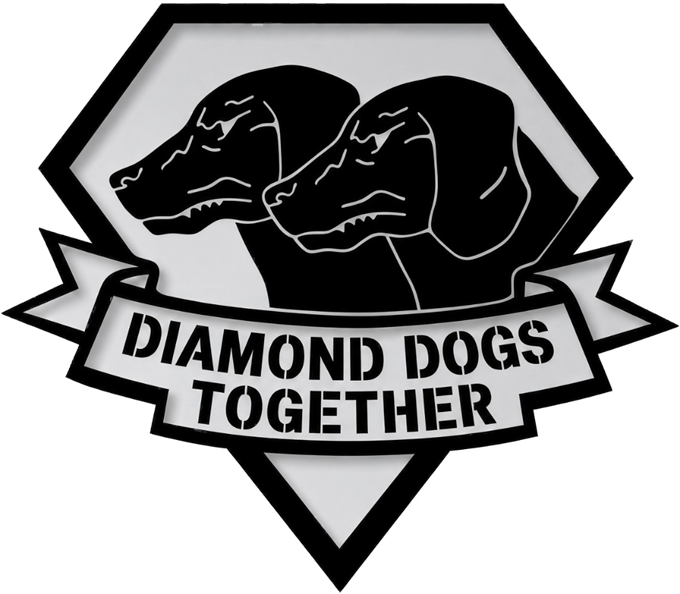
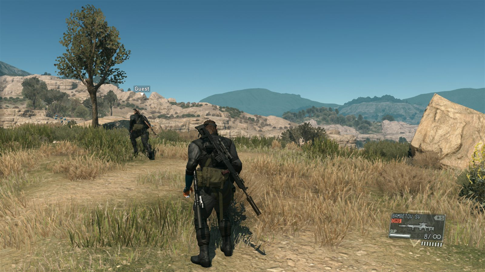

<p align="center">
  
</p>

<p align="center">
  <b>Two-player online co-op for Metal Gear Solid V: The Phantom Pain</b><br>
  Windows · Steam · version 0.14.4 (development build)
</p>

<p align="center">
  
</p>

You and a friend each run your own copy of MGSV and play in the same world. You see each other move, fight, climb, drive and hide.

**What you can play today:** Mother Base and the Afghanistan and Africa free roam. Story missions, the hospital prologue, side ops and cutscenes are **not** co-op yet; see the [campaign roadmap](docs/CAMPAIGN-ROADMAP.md).

## Download

Get `DiamondDogsTogether-<version>.zip` from [Releases](https://github.com/TrollTaylor/diamond-dogs-together/releases). Both players need the **same version**.

The launcher updates itself: when a new version is out, **Update now** downloads it, installs it and restarts Diamond Dogs Together.

The complete source code of each version from 0.14.4 on is `DDT-source-<version>.zip` on the same release page; older packages carry it as `mgs-coop/source.zip`. It is made from the commit of this repository that `mgs-coop/package.json` names (`build.source_commit`), with MinHook's source in place of its submodule link and without the files the programs are not built from (README pictures, git settings, developer notes and scripts, evidence files; [THIRD_PARTY_NOTICES.md](THIRD_PARTY_NOTICES.md) lists them). The tag `v<version>` can sit on a later commit: at least the record of that package in `docs/STATUS.md` is written after it is built. You do not need it to play. The launcher's only network access is that update check against this repository's releases and, on **Update now**, the download of the new zip.

## Requirements

- MGSV: The Phantom Pain on Steam, version 1.0.15.4, with **no other mods**.
- Windows 10 or 11, and Steam running and logged in.
- A save that can **Continue** into Mother Base or free roam (not one still in the hospital opening).

## Install

1. In Steam, right-click MGSV and choose **Manage → Browse local files**. This opens the game folder, the one with `mgsvtpp.exe`.
2. Extract **everything** from the zip into that folder: `DiamondDogsTogether.exe`, `dinput8.dll` and the `mgs-coop` folder.
3. Run **DiamondDogsTogether.exe**.

The first start gets co-op ready by itself, in about a minute (the Play page shows *Getting co-op ready...*; there is nothing to click):
- It checks your game files.
- It backs up your real saves.
- It makes a co-op copy of your save.
- It builds the mod's runtime file from your own game files.

Launching MGSV normally from Steam still plays your real save, with the mod inactive.

## Play

1. **Host:** open **Play → Host → Host game**. MGSV starts and a join code is copied to your clipboard. Send it to your friend, or invite them from the Steam overlay once you are in the game. The host always plays Snake.
2. **Join:** open **Play → Join**, pick your character, paste the code and press **Join game**. Or tick **Wait for a Steam invite**. Character choices:
   - **Story: Quiet or Ocelot.** Quiet while she is on your team, Ocelot otherwise.
   - **Ocelot.**
   - **Diamond Dogs soldier,** male or female.
   - **Your custom character.**
3. **Both:** choose **Continue** and meet up in Mother Base or free roam. If your saves are at different points, the host's save is copied to the joiner automatically and their game restarts once.

Keep the launcher open while you play; its **In game** page shows the connection and your partner's status. Quit MGSV normally when you are done.

## What works

- **Your partner's body:** you see their body, gear and weapons as they walk, run, crouch, crawl, aim, reload and throw.
- **Movement:** ladders, ledges, the cardboard box and item pickups.
- **Vehicles:** your partner drives; you can ride in the front or back seat of a jeep. In Afghanistan and Africa free roam, a world vehicle that nobody drives stays where it was left on both screens and has the body damage the host's PC gives it; either player's Fulton of it removes it on both screens and adds it to both players' Mother Base, one destroyed on the host's PC disappears from the partner's screen, and one the guest blows up near them is destroyed on the host's screen too.
- **Helping each other:** revive a downed partner, wake a sleeping one, and carry them.
- **Shared world:** enemy kills, sleeps and Fultons, alerts, time and weather.
- **Shared progress:** the host's travel, checkpoints, and game over with continue for both players.
- **Online play:** through Steam, with no port forwarding.

## Known limits

- Story missions, the hospital prologue, side ops and cutscenes are not co-op yet.
- **Enemies:** each PC still moves its own enemies. Only what happens to them (killed, asleep, Fultoned, alerted) is shared.
- **Vehicles:** trucks that enemies drive move separately on each PC, and so does an enemy vehicle that drives off in a fight: one the guest destroys after it has moved stays destroyed only on the guest's screen. Wheel damage and fire are not shared, and damage the guest does to a vehicle without destroying it is undone within about 10 seconds. A vehicle the guest destroys from more than about 300 m away (or while the host sits in it on the host's PC) stays destroyed only on the guest's screen. A vehicle the guest destroys is destroyed on the host's PC with the game's own explosion there, soldiers inside included, unless either player stands near the host's copy (within 15 m of a jeep, 50 m of a truck, armoured vehicle or tank): then a named one just disappears on the host's PC, and others (one with soldiers inside, or an unnamed one) wait until both players are clear, for up to 2 minutes; after that the vehicle stays destroyed only on the guest's screen. While D-Dog still sits in the host's copy, the host waits up to 2 minutes for the seat to empty. A vehicle destroyed on the host's PC leaves no wreck on the guest's screen. In Mother Base a parked vehicle's position, damage, Fulton and destruction are not shared yet.
- **Animals and prisoners** are not shared.
- **Buddies** (D-Dog, D-Horse, Quiet, D-Walker) are not shared yet: each PC keeps its own.
- **Seats:** you can ride along in a jeep's front passenger seat or its back seats. When the driver's D-Dog already sits in the jeep's front seat you get a back seat; the dog gets in with the driver, in testing even from about 300 m away. A truck's cab seat works in testing but is off in this version; a truck's bed and the inside of armoured vehicles and tanks aren't available yet. While the vehicle moves, your partner can appear beside their seat for a moment. A front-seat passenger sits in the seat on both screens, also while the jeep drives, and climbs out over the right side. In the front seat your camera can end up inside the jeep or a nearby object when the jeep reverses into something. After you get out of the front seat or the left back seat the camera shows the driver up close for about 2 s (3 s from the back seat) before it turns to look along the jeep behind you; if you aim while getting out it turns after you stop aiming, and only turning the camera yourself keeps it where you put it: walking away does not. Only pressing E takes an empty jeep's driver's seat: standing at its door takes nothing, so a partner waiting at the door no longer locks you out. When the guest presses E at an empty jeep, Snake stands at the door for about a third of a second on a slow connection (the host's game decides) and then gets in, with no second press. If you both press E at the same jeep at about the same moment, the host drives and the guest gets a passenger seat; with the host's D-Dog out the guest waits at the door for about a third of a second while the dog takes the front seat, then gets into a back seat, the same seat on both screens (the back right seat in testing; the guest's screen does not show the host's dog). A host who presses E at the driver's door while the guest is getting in is told that the partner reached the driver's seat first; just standing at the door shows nothing. While that message is up, and while you stand at a vehicle your partner drives, you can't Fulton anything. Shooting from a jeep's seats works only in part: from the front passenger seat and the back seats you can aim and fire, the camera stays on your aim when you fire (you can keep turning and aiming with the mouse or stick while you shoot) and comes back to normal when you stop aiming, and from a back seat your shots hit what the red reticle is on across the jeep (tested on guards 8-21 m away from a stopped jeep, also online; not yet tested while the jeep moves). A shot from a seat whose line passes through your own jeep now starts just outside the jeep, so it does not damage your jeep (unless what you aim at is right next to the jeep). Online on the Afghanistan jeep, with the host in the seat aiming over the shoulder, a shot from the front seat back across the jeep and one from the left back seat down past its tail each took almost a third of the jeep's life without this fix and nothing with it; the back seats of the Africa jeep showed the same in testing, and online its right back seat did no harm. The gun won't fire at a target low beside the jeep or down into it. While you aim from the front seat or the left back seat and the gun can fire, the game now switches to its first-person view by itself (the over-the-shoulder view there is blocked by your own leg or the jeep's side), in both roles, also online; the right back seat keeps the over-the-shoulder view. If the jeep blocks the gun when you raise it (the red no-fire mark, for example aiming across the driver from the front seat), the view stays over the shoulder. Turning the aim to a clear direction then switches to first person in the same aim (tested online from the front seat). In first person, parts of the jeep can fill much of a scoped rifle's view in some directions, from the front seat and from the left back seat. A shot fired that way leaves the view on your aim (it does not climb). When you stop aiming, and when you get out (also while aiming), the normal camera comes back, and your next aim on foot is over the shoulder. Tapping F while aiming switches back to over the shoulder for the rest of that ride (in testing the next aim stayed over the shoulder). If the jeep blocks the gun while you are in first person (the rifle lies across the view, for example when you turn the aim down beside the front seat), the view goes back over the shoulder a moment later and the gun fires from there (tested from the front seat). Online, first-person shots from the front seat fired in both roles, also while the jeep was turning, and the view stayed on the aim. In testing, a first-person shot from the front seat hit a standing guard about 11 m away. Aiming down beside the jeep from the front seat, the over-the-shoulder view looks into the jeep's own seat, but the gun fires. Your partner does not see you aim. While someone sits in a jeep, damage to it counts only on the host's screen: the guest's screen can show different damage until everyone has got out, and then it takes the host's. A jeep you ride that is wrecked on either screen is gone on both.
- **Sortie vehicles:** a vehicle you bring from sortie prep (the helicopter's vehicle choice) doesn't appear on your partner's screen; they see you without it. Use world vehicles you find on the map to ride together.
- **Supply drops:** only the host can order a LOADOUT or VEHICLES supply drop in co-op (both can bring a vehicle), also while the host's game is still loading after you travel together; the guest's iDroid says so.
- **Mounts:** a partner riding D-Horse or D-Walker is hidden.
- **Look:** your custom character may look like Snake on your partner's screen.
- **Players:** two only.

## Troubleshooting

- **Won't connect:** both of you need the same version and Steam online, and the game must be started from the launcher. The launcher's **In game** page and the in-game **CO-OP** line say what is wrong.
- **Different missions:** you only pair in the same Mother Base, free roam or helicopter. If one save always continues into a story mission, use **Tools → Share save** first.
- **Red "Co-op did NOT start" banner:** you are playing normally on your real save. Quit and start the game from the launcher.
- **Reporting a bug:** quit the game, use **Tools → Collect logs** on both PCs, and send the zips it puts on the Desktop. Codes and personal IDs are removed.

## Uninstall

1. Run the launcher and use **Tools → Uninstall**. This turns co-op off, removes `dinput8.dll` and checks your real saves against the backup.
2. Then delete `DiamondDogsTogether.exe`, and the `mgs-coop` folder once you no longer need its backups.

## Building from source

You need CMake, the Visual Studio C++ build tools (x64 Windows SDK) and PowerShell.

```powershell
git clone --recurse-submodules https://github.com/TrollTaylor/diamond-dogs-together.git
cd diamond-dogs-together
pwsh -File tools/Prepare-Dependencies.ps1
./tools/build.ps1 -Configuration Release
```

`tools/package.ps1 -Friend` builds the release from a passing `tools/worker/Invoke-WorkerChecks.ps1 -Profile Release` run: the player zip `DiamondDogsTogether-<version>.zip` and the source zip `DDT-source-<version>.zip`. Every release uploads **both** to the GitHub release `v<version>` (see AGENTS.md, "Releasing").

Testing on one PC: in the launcher, **Settings → Debug mode** adds **Play → Local test (two windows)**. It starts two MGSV copies on this PC (this game folder hosts as Snake, a second game folder joins as Quiet) on separate local-test saves, and puts the test settings in both folders back after both games exit. Choose the second folder under Settings → Debug. The test copies this version's loader, runtime file and `package.json` into the second folder (an older Diamond Dogs Together launcher there is updated too) and they stay there; the files it replaces are kept in that folder's `mgs-coop\install-backups\local-test-<time>`. Its `probe-install.json` is never changed, and a loader that only the developer tools own is not replaced (update it with `tools\package-install.ps1` first). `Play-Offline-Coop.bat` (`tools/dev/Play-LocalCoop.ps1`) does the same from PowerShell; both use the same cleanup journal.

Developer docs:
- [Status and change log](docs/STATUS.md)
- [Campaign roadmap](docs/CAMPAIGN-ROADMAP.md)
- [Partner body](docs/native-puppet.md)
- [World sync](docs/world-sync-protocol.md)
- [Two-PC play](docs/two-pc-play.md)
- [Third-party notices](THIRD_PARTY_NOTICES.md)
