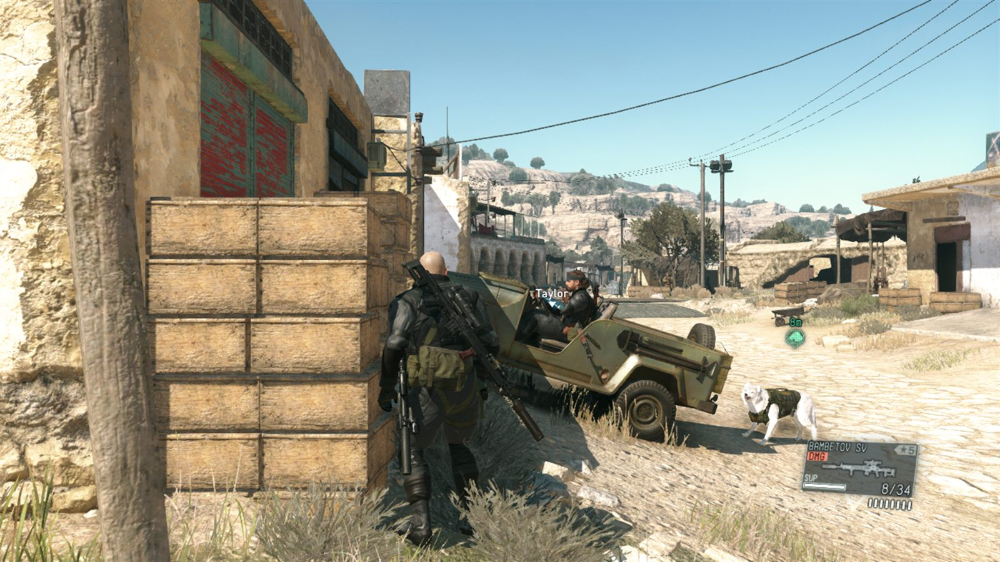
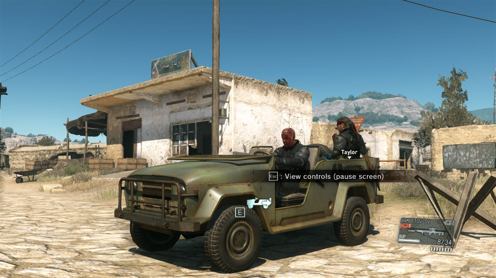
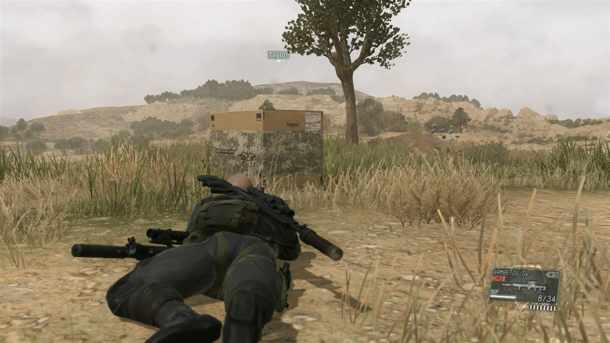
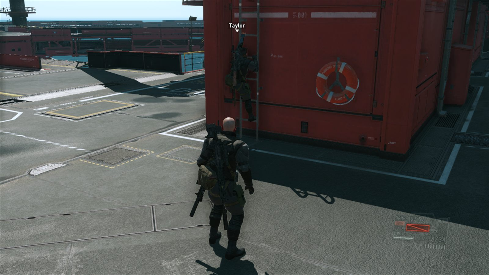
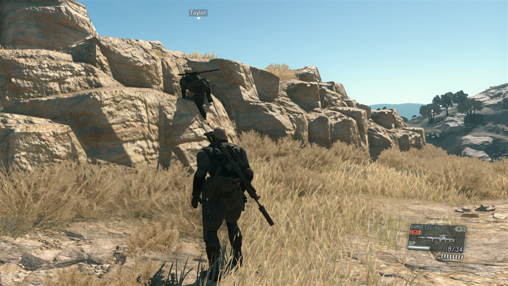
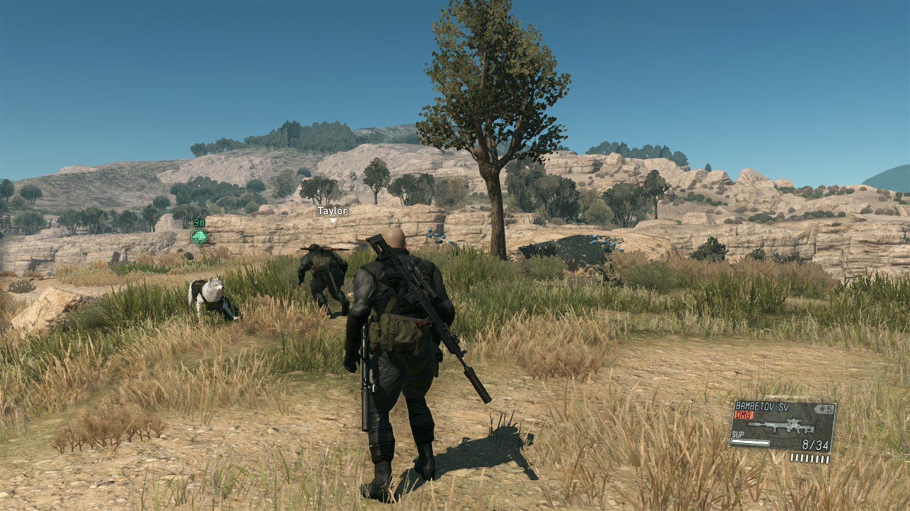

<h1 align="center">
  
</h1>

<p align="center">
  Two-player co-op for <b>Metal Gear Solid V: The Phantom Pain</b><br>
  <b>0.13.5</b> &nbsp;·&nbsp; two players &nbsp;·&nbsp; Windows &nbsp;·&nbsp; Steam
</p>

<p align="center">
  You and a friend each run your own copy of the game. You see each other move, take cover, drive, and hide in Mother Base, Afghanistan, and Africa free roam.
</p>

<p align="center"><i>A development build. The hospital, story missions, side ops, and the endings are still ahead.</i></p>

<br>

<p align="center">
  
  <br>
  <i>Afghanistan free roam. The name above the other soldier is your partner.</i>
</p>

## In the field

<p align="center">Frames from the 0.13.5 sessions on 22 October 2026.</p>

<table>
  <tr>
    <td width="50%" valign="top">
      
      <br><br>
      <b>They drive</b><br>
      A teammate in a jeep or truck sits in the driver's seat on your screen, and the vehicle moves smoothly.
    </td>
    <td width="50%" valign="top">
      
      <br><br>
      <b>The back seat</b><br>
      Press Action beside their jeep to ride along. Your camera stays outside the car. Press Action again to get out.
    </td>
  </tr>
  <tr>
    <td width="50%" valign="top">
      
      <br><br>
      <b>The box</b><br>
      When they hide in a cardboard box, you see the box move with them, and it comes off when they leave it.
    </td>
    <td width="50%" valign="top">
      
      <br><br>
      <b>Ladders</b><br>
      On Mother Base their body climbs the ladders, including the ones on the containers.
    </td>
  </tr>
  <tr>
    <td width="50%" valign="top">
      
      <br><br>
      <b>Ledges</b><br>
      They pull up onto waist-high rocks and ledges with the game's own climb.
    </td>
    <td width="50%" valign="top">
      
      <br><br>
      <b>On foot</b><br>
      Walk, run, crouch, go prone, aim, and reload. D-Dog can be out with you.
    </td>
  </tr>
</table>

## Play with a friend

<table>
  <tr>
    <td width="33%" valign="top">
      <p align="center"><b>1 · Install</b></p>
      <p align="center">Both of you run <b>Install-Coop.bat</b> once. Your real save is backed up and left alone.</p>
    </td>
    <td width="33%" valign="top">
      <p align="center"><b>2 · Host</b></p>
      <p align="center"><b>Play-Coop.bat</b>, then <b>O</b>. Send the code, or invite a Steam friend from the game.</p>
    </td>
    <td width="33%" valign="top">
      <p align="center"><b>3 · Join</b></p>
      <p align="center">Your friend starts Play-Coop first, presses <b>J</b>, and pastes the code. Both Continue into the same place.</p>
    </td>
  </tr>
</table>

Both of you need the same things:

- **MGSV: The Phantom Pain** from Steam, version **1.0.15.4**, with no other mods. The installer stops if the game files are not the original ones.
- This **same 0.13.5 package** on both PCs. An older package will not connect.
- Steam running, each of you logged into your own account.
- A save that can **Continue** into Mother Base or free roam. A save still in the hospital opening always Continues into a story mission, and co-op cannot join that.
- A way to talk (Discord, Steam chat) so the host can send a join code. Steam friends can use an invite instead.
- Windows 10 or 11.

The game stays offline. **"Failed to log in"** on the title screen is expected. Konami's servers are never contacted.

### Install once

1. Quit MGSV.
2. Extract the zip into a normal folder. Do not run anything from inside the zip.
3. Double-click **Install-Coop.bat**.
4. Confirm the game folder. If it asks, in Steam right-click the game, choose **Manage → Browse local files**, and paste that path.
5. Say whether you usually host or join. That only picks a default character. You choose Host or Join again every time you play.
6. Press Enter for the default character (the host keeps theirs, the joiner is Quiet), or pick one.
7. If it asks for `mgs-coop-player-runtime.dat`, put that file next to `Install-Coop.bat` and run the installer again, or drag the file into the window. It is not inside the zip. The package's `RUNTIME-ARCHIVE.txt` says where it comes from.

The installer puts its loader into the game folder, backs up your real saves, and makes a **copy** of your save for co-op. After that, starting MGSV from Steam is still your normal game, on your real saves. Co-op turns on only for a game started with **Play-Coop.bat**.

### Every time you play

Double-click **Play-Coop.bat** and pick one:

| Key | What it does |
| --- | --- |
| **O** | Host online, through Steam. Recommended. |
| **J** | Join an online game. |
| **L** | LAN or VPN, over UDP. |
| **T** | Two windows on this one PC. |
| **Q** | Quit. |

**Host.** Press **O**. A join code is copied to the clipboard, something like `MGS2-…@your Steam id`. Send it to your friend, and keep it private while the game is running. A new code is made every time you host. Or, once you are in the game, press **F9 → Partner / Co-op → Online → Invite a friend**.

**Friend.** Start **Play-Coop.bat first**, press **J**, and paste the code. "Code OK" means it is fine. Or press Enter with no code and accept the host's Steam invite in the overlay (**Shift+Tab**) while this co-op game is running. Accepting an invite while the mod is not running starts ordinary MGSV on your real saves. Quit that and start Play-Coop first.

**Both of you.** Click through the opening screens, choose **Continue**, and meet in Mother Base or in Afghanistan or Africa free roam. Stay near each other. A partner who is far away is hidden until you meet again.

Leave the Play-Coop window open. About once a second it prints a line like:

```text
[HOST] link=connected via Steam (relay) rtt=61ms | partner=live shown | mission 30050
```

`link=connected` means the two PCs are talking. `partner=live shown` means your partner is on screen. The same news appears in the game as a **CO-OP** line at the top right.

Quit MGSV normally when you are done. Co-op switches itself off, and the next launch from Steam is your real save again.

### Same point in the story

Co-op pairs when both games are in the same Mother Base, free roam, or helicopter.

If the joiner's co-op save would start somewhere else, the host's save is copied across at the title screen and MGSV restarts once on it. Keep the Play-Coop window open. That takes about a minute. The host's save is shared only once it already continues into Mother Base or free roam. Your own co-op copy is kept aside. **Share-Save.bat**, then **R**, brings it back. Your real saves are never part of this.

To share by hand instead: the player who already has Mother Base quits the game, runs **Share-Save.bat**, presses **E**, and sends the zip from the Desktop. The other player quits, runs **Share-Save.bat**, presses **I**, and drops that zip in.

### On one PC

**Play-Coop.bat**, then **T**. **Play-Offline-Coop.bat** is the same choice.

It uses your installed game and a second copy. It looks first for a folder next to yours named `<your game folder>_guest`. If that is missing, it asks you to paste the second game folder. It does not download or create a second install.

The host window opens on the left and the guest on the right. Click through each game yourself and Continue in both. Keyboard and mouse control the window you click. A controller in slot 0 controls the guest, so one pad cannot move both players. Press **R** in the launcher if the windows need lining up again.

This rehearses the gameplay over a local link. A real Steam connection still needs two PCs.

## What works in 0.13.5

In Mother Base (`30050`) and Afghanistan and Africa free roam (`30010`, `30020`):

- Your partner's body, face, camouflage, and weapons. They walk, run, crouch, go prone, aim, reload, and switch guns. Aim works with toggle aim too.
- Their name above them.
- A grenade or an empty magazine actually leaves their hand. It is the animation only: no second grenade appears, and your own grenade count does not change.
- The cardboard box, ladders, ledge climbs, and the standing pickup.
- Driving. You see them in the driver's seat of a jeep or truck, and the vehicle updates smoothly. While they drive, you can no longer climb into that same driver's seat (that used to make a second driver and hide them).
- The back seat of a light vehicle, with your own camera behind the car. Trucks and armored vehicles have no passenger seat: while they drive one of those, you stay out.
- Wounds and sleep. A gun injury leaves you crawling, unable to aim or fire, until a teammate revives you. A friendly sleep dart puts you to sleep with your health kept, in the game's own sleep. Sleep ends when a teammate wakes you, or after 30 seconds.
- Wake or revive from within **3 meters**: close F9 if it is open, and hold **Action** (**E**, or **Y** after you have used a controller) for **3 seconds**. A short interruption drains the bar instead of starting it over. A revived player has 3 seconds of protection.
- Carry. Hold **Carry** (**R**) beside a wounded or sleeping teammate, walk, and hold it again to put them down. The carried player's camera follows from behind the carrier.
- D-Dog. The guest's dog follows the host's dog. Attacks, spotting, and the dog's health stay on each PC.
- The world, when you leave the default session alone. Alerts, the clock, the weather, the host's travel, checkpoints, and recovering together from **MISSION FAILED**. The joiner follows the host's travel. Doing the same trip again within a short window goes alone, and **F9 → Partner / Co-op → Travel lock** turns the lock off for that session.
- Online play through Steam, with no port forwarding. Steam connects you directly or through its relays. A code works between any two players. An invite works between Steam friends. LAN and VPN play is the **L** option, on UDP port **47830**. Tailscale, ZeroTier, or the same home network is the easy version of that.

Each of you shoots your own copy of the world. You see the other player's muzzle flash, sound, aim, and reload. The hits that count are the ones fired on the PC where that player is sitting.

## Still unfinished

- Story missions, the hospital opening, side ops, rewards, and the endings.
- A third or fourth player.
- Aiming, shooting, or a first-person view from the back seat.
- D-Horse and D-Walker. While your partner rides either one, their body is hidden and comes back when they get off. You do not see a horse or a walker under them, and you cannot share one mount.
- Getting out of the cardboard box. The box comes off, without the exit motion.
- Hand signs, knocking, wall cracks, and pipes.
- C4. In online play your partner does not yet kneel to place a charge or press the detonator. That animation exists only in the developer test mode.
- A slow walk (**Ctrl+W**) can play the run animation in place. That is an older issue, still here.
- A fresh two-PC session on this exact build. Two copies on one machine have been through these scenes, including a simulated bad connection. The last session a player reported from two separate houses was **0.12.0**.

## If it does not connect

The Play-Coop line and the in-game **CO-OP** line usually say why.

- `link=connecting` for a long time: the joiner cannot reach the host. On Steam, both PCs need to be online, the host's game needs to be running from Play-Coop, and **Accept joins** needs to be on. On LAN or VPN, check that both PCs are on the VPN and that the code is the one labeled with that network.
- `Your friend runs mgs-coop X; you run Y`: install the same package on both PCs.
- Different missions: meet in the same Mother Base, free roam, or helicopter. If one game always Continues into a story mission, share a save first.
- A red banner, **Co-op did NOT start and save protection is NOT active**, means this launch is ordinary play on your real saves. Quit if that is not what you wanted.

The long list of messages is in the package's **FRIEND-GUIDE.txt**, and in [two-PC play](docs/two-pc-play.md).

To send a report: quit the game, double-click **Collect-Logs.bat**, and send the zip it puts on the Desktop. Join codes, the link key, and your Windows user name are removed. Steam ids are cut down to the last four digits.

## Your saves

Co-op plays on a copy made at install. Your real save files are backed up and are not written during co-op games. Progress does not cross between the two: co-op progress stays in the copy, and the copy does not pick up later progress from a normal game.

When you want the mod gone: quit MGSV, double-click **Uninstall-Coop.bat**, and press Enter. It puts back what was in the game folder before, and it checks that your real saves still match the backup from install. It does not overwrite saves. The backup, the co-op copy, and the logs stay in the game's `mgs-coop` folder until you delete that folder yourself.

## Building it

The friend package is the way to play. Building from this checkout is for working on the mod.

Clone with submodules, then prepare the pinned source dependencies. Lua 5.1.5 is used only by the test fixtures. The script checks the Lua archive and the MinHook revision, and it does not launch or install the game.

```powershell
git clone --recurse-submodules https://github.com/TrollTaylor/diamond-dogs-together.git
cd diamond-dogs-together
pwsh -File tools/Prepare-Dependencies.ps1
./tools/build.ps1 -Configuration Release
```

You need CMake, the Visual Studio C++ build tools with an x64 Windows SDK, and PowerShell. `-BuildOnly` compiles without the test run. A source build does not by itself prove a gameplay change. Exact game-script checks need your own licensed Lua extract in `MGS_GAME_LUA_DIR`.

`tools/package.ps1 -Friend` writes `dist/mgs-coop-friend-<version>-<stamp>` and a zip with `Install-Coop.bat`, `Play-Coop.bat`, `Uninstall-Coop.bat`, `Collect-Logs.bat`, and `FRIEND-GUIDE.txt`. The runtime archive stays local and is never put in the zip.

Adapted third-party code, including Dynamite, is listed with versions and licenses in [THIRD_PARTY_NOTICES.md](THIRD_PARTY_NOTICES.md).

Where to go next:

- [Current status and evidence](docs/STATUS.md) — what 0.13.5 changed, what was checked, and what is still open.
- [Two-PC play](docs/two-pc-play.md) and [Steam online](docs/steam-online.md) — the connection, in detail.
- [Debug menu](docs/debug-menu.md) — F9, once you are in a co-op session.
- [Campaign design](docs/campaign-design.md) — the full game, as planned.
- [Native partner](docs/native-puppet.md) — how the other player's body is driven.

<details>
<summary>Older notes</summary>

The `docs/` folder is also the lab notebook: world sync, animation rounds, the save handoff, and the Steam and engine investigations. Those notes describe how a piece was checked. They are not instructions for playing.

</details>
